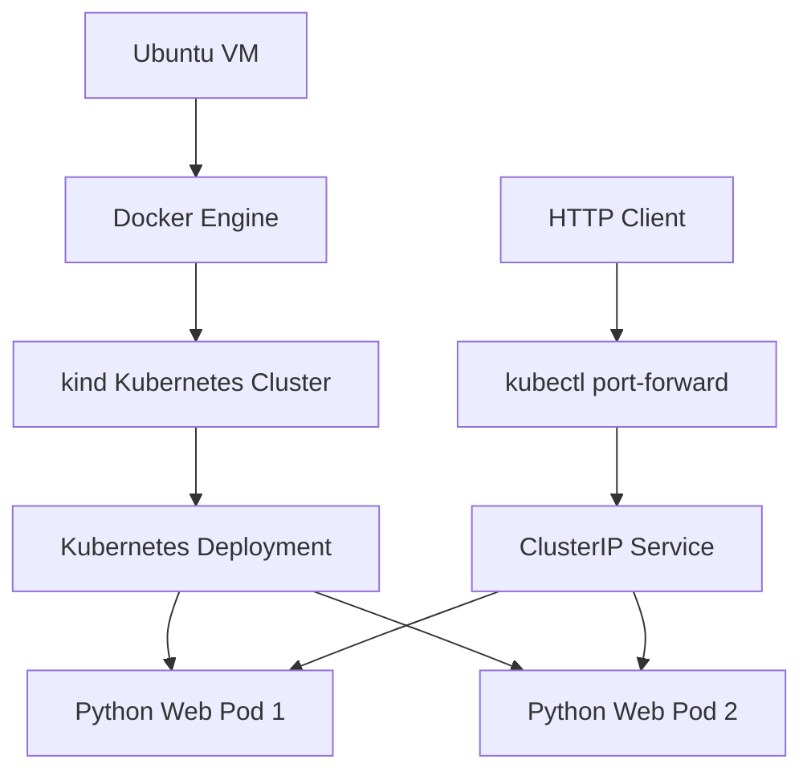

# Mission 02 — Kubernetes Architecture

## Overview

This lab runs a Python web application inside Docker containers managed by a single-node Kubernetes cluster created with kind.

## Architecture Diagram

## Components

- Docker builds the Python application images.
- kind creates the local Kubernetes cluster.
- Kubernetes Deployment manages two application replicas.
- ClusterIP Service routes traffic to ready pods.
- Readiness and liveness probes monitor application health.

## Application Ports

| Component | Port |
|-----------|------|
| Python application | 8080 |
| Kubernetes Service | 80 |
| Local port-forward | 18081 |

## Resource Configuration

| Resource | Request | Limit |
|----------|---------|-------|
| CPU | 25m | 250m |
| Memory | 32Mi | 128Mi |

## Limitations

This lab uses one Kubernetes node. Two application replicas demonstrate workload recovery but do not provide protection against failure of the underlying node.
