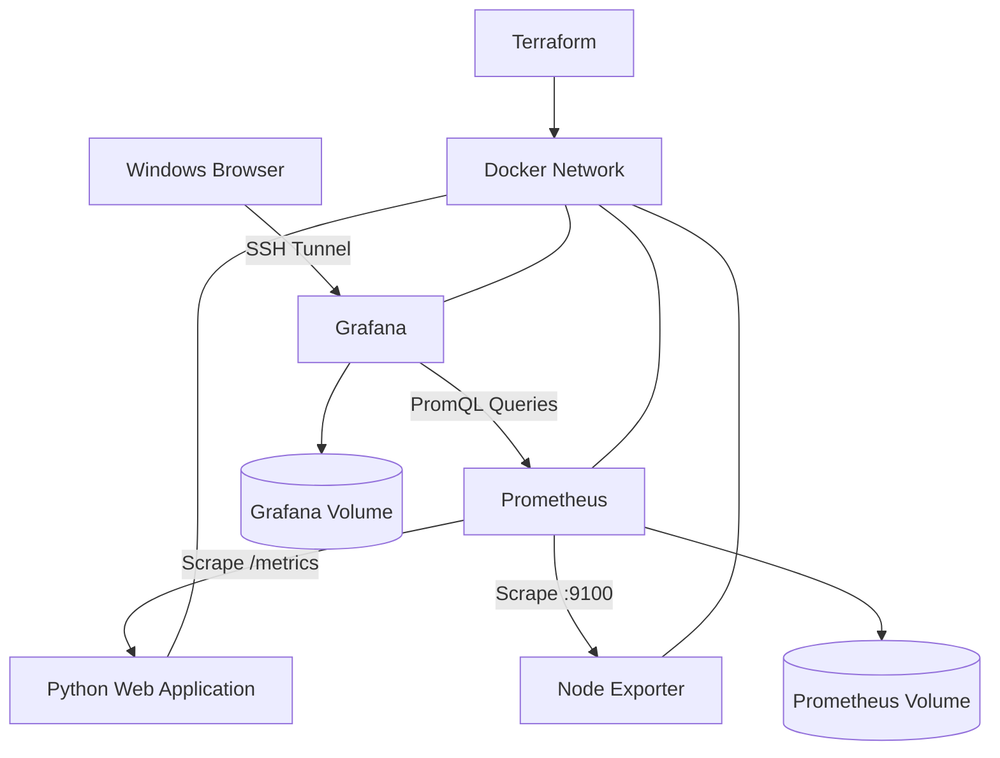

# Mission-03 Monitoring Architecture

## Overview

Mission-03 demonstrates a containerized observability platform
managed using Terraform on an Ubuntu Linux virtual machine.

## Architecture Diagram

## Infrastructure Components

### Python Application
- Docker container: mission03-web
- Container port: 8080
- Ubuntu loopback port: 8081
- Exposes application and health endpoints
- Publishes Prometheus-compatible metrics

### Prometheus
- Docker container: mission03-prometheus
- Port: 9090
- Scrape interval: 15 seconds
- Collects application and Node Exporter metrics
- Uses persistent Docker storage

### Node Exporter
- Docker container: mission03-node-exporter
- Port: 9100
- Collects CPU, memory, and filesystem metrics

### Grafana
- Docker container: mission03-grafana
- Port: 3000
- Uses provisioned Prometheus data source
- Loads the Mission-03 dashboard from JSON
- Uses persistent Docker storage

## Network Security

All monitoring services connect through the
mission03-network Docker bridge network.

Published web ports are bound to the Ubuntu loopback interface.

Windows browser access uses SSH local port forwarding.

## Verification

Terraform successfully validated the infrastructure and
reported no configuration drift.

Prometheus reported all three monitoring targets as UP.

Grafana displayed application availability, request activity,
response latency, CPU, memory, and filesystem metrics.
